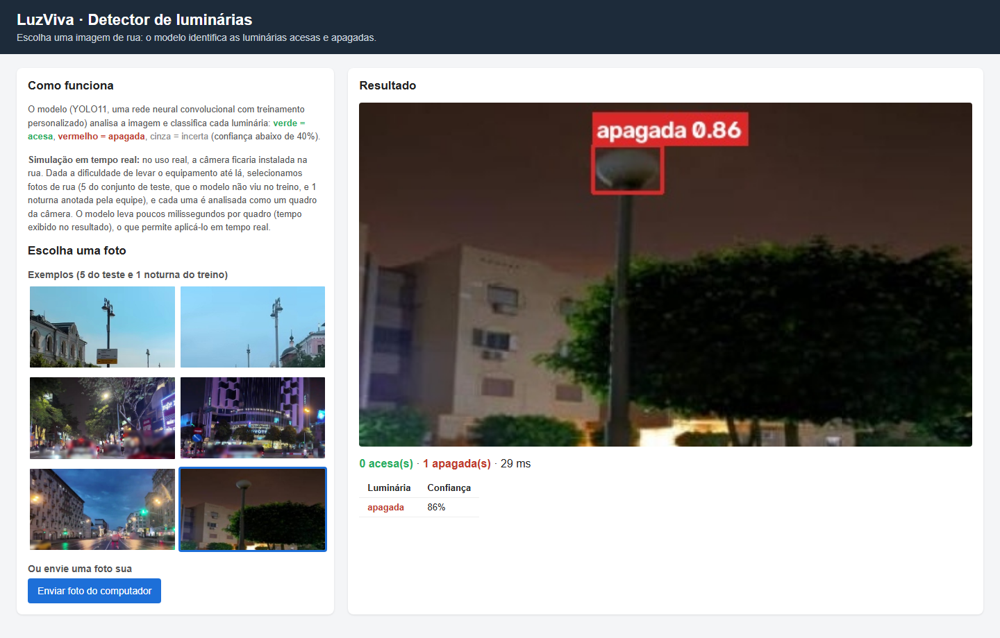
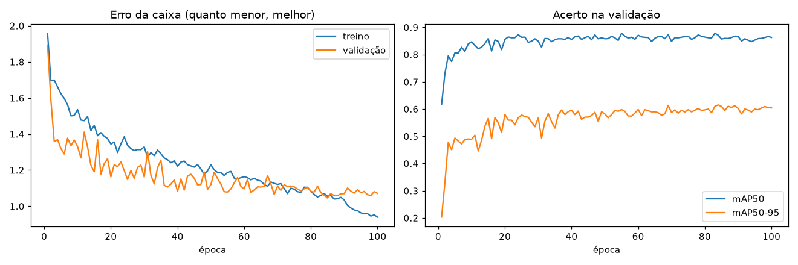
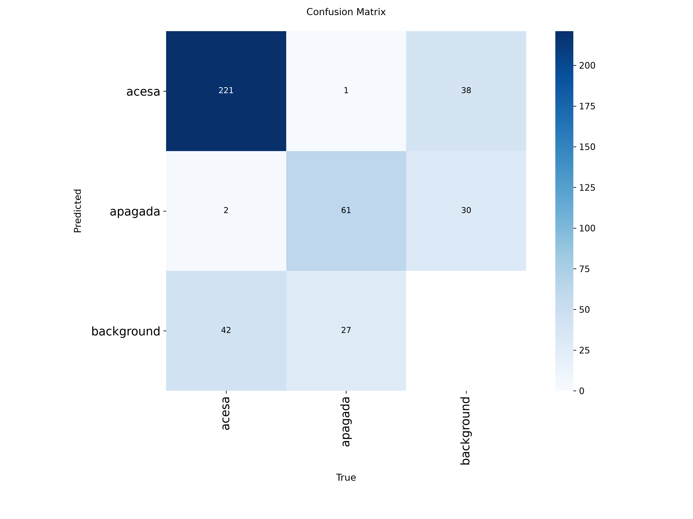
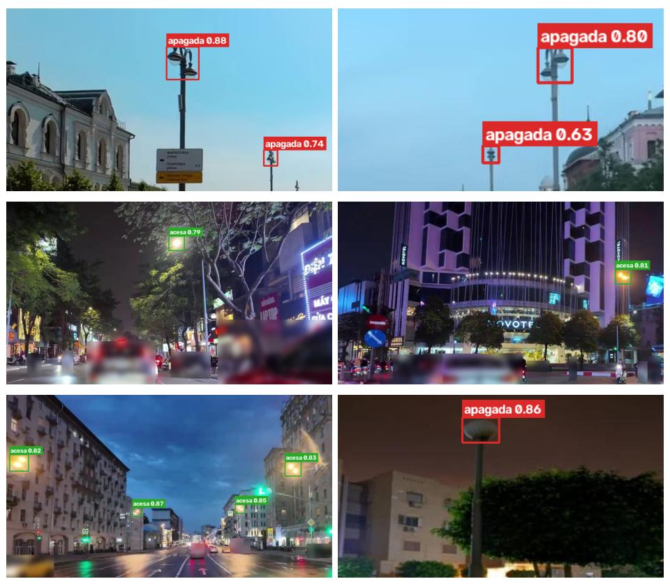

# LuzViva - Detector de Luminárias

Applied Computer Vision - Global Solution 2026.2 - 4-ESPY

## Integrantes

- Caíque Walter Silva - RM550693
- Guilherme Monteiro Espim - RM99499
- Guilherme Nobre Bernardo - RM98604
- João Paulo Fonseca Zamperlini - RM99279
- Matheus José de Lima Costa - RM551157

## Ficha Técnica

- **Projeto:** LuzViva
- **Problema:** atualmente, uma luminária apagada só é identificada quando um morador registra uma reclamação. Até o reparo, a via permanece escura, o que aumenta o risco de acidentes e de crimes
- **Solução:** detecção automática de luminárias em imagens de rua (fotos ou quadros de câmera), com a classificação de cada uma como acesa ou apagada
- **Modelo:** YOLO11n (rede neural convolucional) com treinamento personalizado para as classes acesa e apagada
- **ODS:** 11, 9 e 10

## Funcionamento

1. `contar()` resume o dataset: imagens de rua anotadas com uma caixa delimitadora por luminária.
2. `treinar()` ajusta o YOLO11n pré-treinado às duas classes do projeto: acesa e apagada.
3. `detectar()` recebe uma imagem e retorna as luminárias encontradas, com a classe e a confiança de cada uma.

As funções estão implementadas em `visao.py`, e o notebook `visao.ipynb` executa todas as etapas e apresenta os resultados.



A interface web permite selecionar uma das imagens de exemplo (5 do conjunto de teste, não utilizadas no treinamento, e 1 imagem noturna anotada pela equipe) ou enviar uma imagem própria. Legenda: verde = acesa, vermelho = apagada e cinza = incerta (confiança abaixo de 40%).

## 01. Dataset

O dataset utilizado está na pasta `dataset/`, já dividido em treino, validação e teste, no formato YOLO. Ele foi montado a partir de duas fontes.

**Lamp State Detection.** Foi utilizado o dataset [Lamp State Detection](https://huggingface.co/datasets/ngocleltt/lamp-state-detection) (Hugging Face, licença CC BY 4.0), composto por quadros de vídeos de rua com cada luminária anotada como acesa ou apagada, no formato YOLO.

| Conjunto | Imagens | Caixas acesa | Caixas apagada |
|---|---|---|---|
| Treino | 1.171 | 3.108 | 555 |
| Validação | 181 | 235 | 142 |
| Teste | 178 | 265 | 89 |

- Foram utilizados 8 dos 10 vídeos; os outros 2 foram descartados por apresentarem neve.
- Como quadros consecutivos são praticamente idênticos, manteve-se 1 a cada 6 quadros (1 a cada 2 nos quadros com luminárias apagadas, que são menos frequentes).
- A divisão entre treino, validação e teste foi feita em blocos de 10 quadros consecutivos, evitando que o conjunto de teste contenha imagens quase iguais às do treino.

**Imagens complementares do Roboflow (utilizadas apenas no treino).** O dataset principal possui poucas imagens noturnas: as luminárias apagadas aparecem quase sempre durante o dia, e apenas as luminárias próximas estão anotadas. Para reduzir essa limitação, foram incorporadas 100 imagens de datasets públicos do Roboflow (CC BY 4.0):

| Imagens | Descrição |
|---|---|
| 70 `noite_XX` | vias noturnas com várias luminárias acesas anotadas ([street_light_on](https://universe.roboflow.com/datasets-cobjh/street_light_on)) |
| 26 `apagada_XX` | imagens noturnas com luminárias apagadas, **anotadas manualmente pela equipe** no Roboflow ([street-light-off](https://universe.roboflow.com/datasets-cobjh/street-light-off)) |
| 4 `dia_XX` | imagens diurnas com luminárias apagadas corretamente anotadas (street-light-off) |

Na pasta `dataset/train/`, as imagens do Lamp State Detection seguem o padrão `<vídeo>_<quadro>.jpg`, e as complementares mantêm os prefixos acima. Cada imagem possui um `.txt` correspondente em `labels/`, com uma linha por luminária.

## 02. Treinamento

O treinamento partiu do `yolo11n.pt`, pré-treinado no dataset COCO para a detecção de objetos em geral, ajustado ao dataset do projeto por meio de transfer learning.

- 100 épocas, imagens de 640 px, batch 8, seed 42, `patience=20`
- Tempo de treinamento: 21 min em uma GPU RTX 5050
- Modelo final: `modelo/luzviva.pt`



Configurações avaliadas até a definição do modelo final:

| Configuração | mAP50 | Recall apagada | Decisão |
|---|---|---|---|
| YOLO11n, apenas o dataset principal | 0,79 | 0,66 | referência |
| YOLO11s com imagens de 960 px | 0,79 | 0,74 | descartado: desempenho equivalente e inferência 2x mais lenta |
| **YOLO11n + 100 imagens complementares** | **0,77** | **0,70** | **selecionado** |

A última configuração foi selecionada porque, apesar de uma pequena redução no mAP50 geral, deixa de detectar menos luminárias apagadas. No contexto do LuzViva, uma luminária apagada não detectada é mais grave que um alarme falso, que pode ser verificado posteriormente.

## 03. Resultados no conjunto de teste

Avaliação em 178 imagens não utilizadas no treinamento.

| Classe | Precisão | Recall | mAP50 | mAP50-95 |
|---|---|---|---|---|
| acesa | 0,84 | 0,84 | 0,91 | 0,68 |
| apagada | 0,66 | 0,70 | 0,64 | 0,36 |
| **todas** | **0,75** | **0,77** | **0,77** | **0,52** |



Análise da matriz de confusão, com o limiar de confiança utilizado na interface (0,4):

- A confusão entre as classes é mínima: 3 trocas em 354 luminárias.
- O erro predominante é a **não detecção**: 27 das 89 luminárias apagadas não foram encontradas. Luminárias apagadas são pequenas, escuras, sem o brilho característico das acesas, e possuem menos exemplos no treinamento.
- Foram registrados 68 falsos positivos (detecções sem luminária correspondente).
- Como o dataset principal anota apenas as luminárias próximas, o modelo tende a não detectar as luminárias mais distantes.
- O conjunto de teste possui poucas luminárias apagadas em cenas noturnas e, portanto, não avalia adequadamente o cenário que as imagens complementares buscaram melhorar.

## 04. Tempo real

O modelo processa cada imagem em cerca de 20 ms, o que corresponde a aproximadamente 50 quadros por segundo. Como uma câmera convencional grava 30 quadros por segundo, o modelo é capaz de operar em tempo real.

Em uma aplicação real, a câmera ficaria instalada na via. Dada a dificuldade de levar o equipamento até o local, a interface simula esse cenário: cada imagem de exemplo é processada como um quadro da câmera, e o tempo de inferência é exibido junto ao resultado.

## 05. Exemplos



Cinco imagens do conjunto de teste e uma imagem noturna anotada pela equipe (usada no treino), com pessoas e veículos desfocados (LGPD).

## 06. Execução

Basta executar o arquivo `rodar.bat`, que instala as dependências necessárias e abre a interface em `http://localhost:8002`.

Execução manual:

```bash
pip install -r requirements.txt
uvicorn app:app --port 8002
```

Para treinar o modelo novamente, execute o notebook com a chamada `treinar()` descomentada.

## Conclusão

O YOLO11n alcançou mAP50 de 0,77 no conjunto de teste e opera em tempo real.

O modelo apresenta bom desempenho na detecção de luminárias acesas (mAP50 de 0,91) e maior dificuldade com as apagadas (0,64), que são menos visíveis e menos frequentes nos dados.

**Links:**

- Repositório: https://github.com/GS-LuzViva/Visao-Computacional
- Vídeo: https://youtu.be/ocx9vJPUMY0
